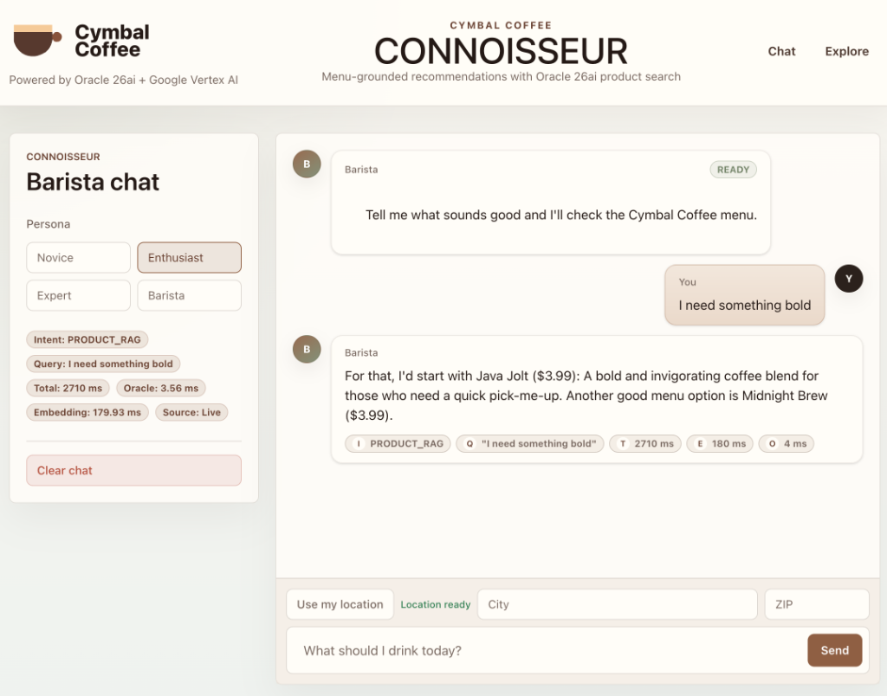

# Cymbal Coffee: Oracle 26ai + Vertex AI + Oracle APEX 26.1

Reference app for AI-powered product search and store operations on Oracle AI
Database 26ai with single-query Hybrid RRF retrieval (Oracle Text lexical
ranking + HNSW vector search), Vertex AI `gemini-embedding-2`, native
`google-genai` `AgentRuntime` (`Gemini 3.8 Flash`), **Oracle APEX 26.1**
(`APEX_AI.GENERATE` connected to Vertex AI), `LitestarMCP`, `LitestarA2A`,
`litestar-queues`, SQLSpec `0.69.0`, HTMX, and Vite.

<div align="center">
  
</div>

## Quickstart

Prerequisites: Python 3.12+, Docker or Podman-compatible local containers,
`make`, and Google Vertex AI (or Gemini API key) credentials. Install Oracle
SQLcl `26.1.2+` (`make install-sqlcl`) when validating, importing, or exporting
Oracle APEX 26.1 `APEXlang` sources.

```bash
make install
uv run python manage.py init
make start-infra
uv run coffee upgrade
uv run coffee run
```

`make install` bootstraps `uv` if it isn't already on your PATH, then installs
Python and frontend dependencies and builds the Vite assets that Litestar
serves. `uv run python manage.py init` writes `.env` (`LITESTAR_PORT=8000`,
deployment mode, database connection, Vertex AI project) without re-running the
install.

`make start-infra` (`uv run python manage.py infra start`) launches the
persistent **Oracle Autonomous AI Database Free 26ai** container
(`container-registry.oracle.com/database/adb-free:latest-26ai`, container
`cymbal-adb-free`), exports and normalizes its mTLS wallet into `.envs/tns` for
service `myatp_low` on TLS port `1522`, and provisions schema/user `APP` plus
workspace `COFFEE` on the pre-bundled **Oracle APEX 26.1.5 + ORDS 26.3** runtime
(<https://localhost:8443/ords/apex>, Database Actions at
<https://localhost:8443/ords/sql-developer>). Setting
`ORACLE_CONTAINER_FLAVOR=free` switches to lightweight `gvenzl/oracle-free:latest`
on `:1521/freepdb1` (mounting `tools/oracle/on_init/00_configure_vector_memory.sql`
and `tools/oracle/on_startup/00_verify_vector_memory.sql`) for non-APEX local
runs and ephemeral `make test-integration` containers.

Open <http://localhost:8000>. The chat page is `/`; the Oracle vector explorer
is `/explore`.

If `.env` still has the placeholder `GOOGLE_PROJECT_ID=demo-project`
(`VERTEX_AI_PROJECT_ID=${GOOGLE_PROJECT_ID}`), REST AI endpoints return HTTP `503`
(`AIServiceUnconfigured`) and `POST /api/chat/stream` emits a structured SSE
`error` event until real Vertex AI credentials are configured. Use Application
Default Credentials (`gcloud auth application-default login`) or clear the
project ID and set `GOOGLE_API_KEY` / `VERTEX_AI_API_KEY`.

## Oracle APEX 26.1 + Vertex AI

The source-controlled **Cymbal Coffee — Vertex AI & Operations** APEX 26.1 application lives
in `src/apex/cymbal-coffee-ops/` (`compatibilityMode: 26.1`, Application ID
`100`), including Page 6 (**Vertex AI Coffee Concierge**, invoking
`APEX_AI.GENERATE` with `COFFEE_VERTEX_AI` grounded on live `PRODUCT` rows).

### Method 1 (Primary): Direct Vertex AI OpenAI-Compatible Endpoint

Connects Oracle APEX 26.1 directly to Vertex AI's OpenAI-compatible endpoint
(`https://aiplatform.googleapis.com/v1/projects/{project}/locations/{location}/endpoints/openapi`)
with `model="google/gemini-3.8-flash"`, provisioning `DBMS_NETWORK_ACL_ADMIN`
host ACEs for `aiplatform.googleapis.com:443`, the `VERTEX_AI_CRED` OAuth2
Bearer credential, and the `COFFEE_VERTEX_AI` Generative AI Service (`Used by
App Builder = Yes`):

```bash
uv run python manage.py infra apex configure-vertex --mode direct --project "$VERTEX_AI_PROJECT_ID" --verify
# Refresh the short-lived OAuth2 Bearer token (~60 minutes) without recreating ACLs:
uv run python manage.py infra apex configure-vertex --mode direct --refresh-token --verify
```

### Method 2 (Secondary): Litestar OpenAI-Compatible Gateway

For zero-expiry local development or Context-Aware Access mTLS workstations,
route `COFFEE_VERTEX_AI` through Cymbal Coffee's local Litestar gateway
(`http://host.docker.internal:8000/api/apex/ai/v1`, serving
`GET /api/apex/ai/v1/models` and `POST /api/apex/ai/v1/chat/completions` on
`ApexAIController` in `src/app/domain/products/controllers/_apex_ai.py`, with
optional `APEX_GATEWAY_API_KEY` Bearer protection):

```bash
uv run python manage.py infra apex configure-vertex --mode gateway --verify
```

### APEXlang App Validation & Import

```bash
make apex
uv run python manage.py infra apex validate --alias cymbal-coffee-ops
uv run python manage.py infra apex import --alias cymbal-coffee-ops --workspace COFFEE --schema APP --app-id 100
```

## What's Inside

- `130` Cymbal Coffee products, `17` stores, `1,700` store-inventory rows, `25` route exemplars across `5` route labels, and committed `gemini-embedding-2` fixtures in `src/app/db/fixtures/`.
- Oracle `VECTOR(3072, FLOAT32)` storage with HNSW `INMEMORY NEIGHBOR GRAPH` (`FETCH APPROX`) and `CTXSYS.CONTEXT` `MULTI_COLUMN_DATASTORE` indexes.
- Single-query Oracle 26ai Hybrid RRF routing and retrieval (`hybrid-search-turn` + `hybrid-term-hits`) fusing Oracle Text lexical ranking (`CONTAINS` / `SCORE`) and HNSW cosine similarity without a separate LLM intent classifier call.
- Native `AgentRuntime` (`google-genai`, `Gemini 3.8 Flash`) with `CallContext`-bound tools (`CoffeeToolContext`), Oracle-backed `agent_session` / `agent_event` stores, `LitestarMCP` (`POST /mcp`), `LitestarA2A` (`POST /a2a`), and `litestar-queues` background workers on Oracle 26ai.
- SQLSpec `0.69.0` async Oracle configuration (`OracleLoaderService`, `FrozenBaseStruct`, `create_container()`, `driver_features={"enable_session_tracing": True}`, wire-level `sqlcommenter`, `wallet_zip` mTLS support, default `fetch_lobs=False` returning LOBs under 1 GB inline, and isolated `DatabaseSettings.get_queue_config()` with `session_key="queue_db_session"`).
- Source-controlled Oracle APEX 26.1 `APEXlang` operations app (`src/apex/cymbal-coffee-ops/`), packaged Cloud Run CDN script (`src/app/db/sql/deploy/configure-apex-cdn.sql`), and deterministic VHS (`docs/_tapes/`) + headless Playwright/FFmpeg (`tools/demos/`) demo video recorders.
- HTMX + Tailwind + vanilla JavaScript pages for chat (`/`) and vector-plan exploration (`/explore`).

## End-user and DevOps commands

| Command | Purpose |
| --- | --- |
| `uv run coffee run [--no-worker]` | Start the Granian + Litestar server on `http://localhost:8000` (with embedded queue worker by default) |
| `uv run coffee worker run` | Start a standalone `litestar-queues` worker fleet |
| `uv run coffee worker status` | Inspect background task queue counts |
| `uv run coffee upgrade` | Apply migrations and load committed demo data |
| `uv run coffee load-fixtures` | Load committed fixture tables without running migrations |
| `uv run coffee export-fixtures` | Export database tables to JSON / `.json.gz` fixtures |
| `uv run coffee bulk-embed` | Refresh embeddings via `products.embed_missing` on `litestar-queues` (`execution_backend="immediate"`) |
| `uv run coffee clear-cache --force` | Clear `response_cache` and `embedding_cache` tables |
| `uv run coffee model-info` | Check active Vertex AI model configuration |
| `uv run coffee configure-apex-cdn` | Configure Oracle APEX `IMAGE_PREFIX` CDN (`src/app/db/sql/deploy/configure-apex-cdn.sql`) |
| `uv run python manage.py infra apex status` | Check Oracle APEX 26.1.5 + ORDS 26.3 release and HTTPS readiness (`make apex`) |
| `uv run python manage.py infra apex configure-vertex` | Provision Direct Vertex AI (`/endpoints/openapi`) or Litestar Gateway (`/api/apex/ai/v1`) in APEX 26.1 |
| `uv run --group demos python manage.py demos check` | Verify VHS, `ttyd`, FFmpeg, Chromium, and Playwright demo recording prerequisites |
| `make docs-demos-shell` | Record VHS terminal and SQLcl demo videos (`uv run python manage.py demos shell`) |
| `make docs-demos-web` | Record headless Playwright + FFmpeg APEX 26.1 browser demo videos (`uv run --group demos python manage.py demos web`) |
| `make docs-demos-live` | Interactively confirm (`RECORD LIVE DEMOS`) and record all VHS terminal and Playwright browser demos via `./tools/scripts/record-live-demos.sh` (requires `uv sync --group demos`) |
| `make docs-demos-clean` | Remove generated demo media under `docs/_static/demos/` |

## Documentation

The Sphinx documentation site (`make docs`, or `make docs-serve` on
`http://localhost:8002`) is the home for the long-form material:

- **Walkthrough** — what one chat message actually does, end to end.
- **Concepts** — vectors in Oracle, Hybrid RRF RAG, native AI runtime routing, and map links.
- **Reference** — quickstart, CLI reference, API reference, and an internals appendix.
- **Developers** — raw migration entrypoint, fixture regeneration, demo video recording, and verification commands.

External references:

- Oracle vectors: <https://docs.oracle.com/en/database/oracle/oracle-database/23/vecse/>
- Oracle APEX: <https://docs.oracle.com/en/database/oracle/apex/>
- Vertex AI: <https://cloud.google.com/vertex-ai/docs>
- Litestar: <https://docs.litestar.dev/>
- SQLSpec: <https://sqlspec.dev>

## Troubleshooting

AI service returns 503:
Replace placeholder Vertex settings in `.env` and confirm ADC or API-key auth.
`uv run coffee model-info` shows the active model settings.

HNSW migration fails with `ORA-51962`:
Autonomous AI Database Free (`adb-free:latest-26ai`) manages vector memory
automatically. On lightweight `ORACLE_CONTAINER_FLAVOR=free`
(`gvenzl/oracle-free:latest`) or self-managed external instances, set
`vector_memory_size` on the SPFILE as `SYSDBA` (`512M` on Free Edition) and
restart the database instance.

Chat feels slow:
Use `/explore` to inspect Oracle timing and `EXPLAIN PLAN` output, then clear
stale caches with `uv run coffee clear-cache --force` before re-testing.
